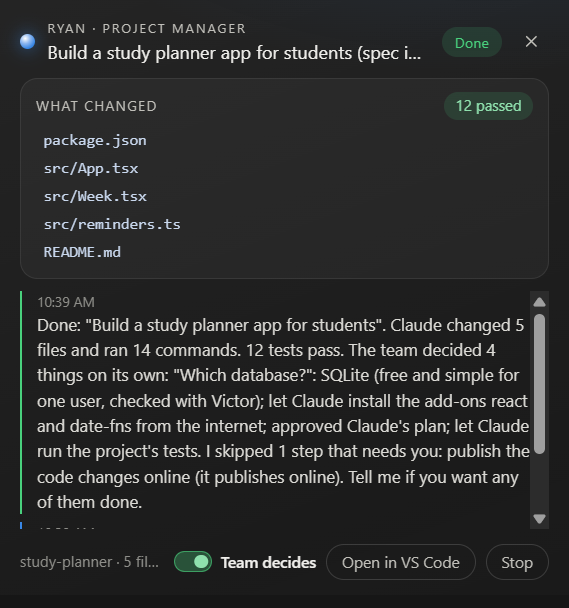
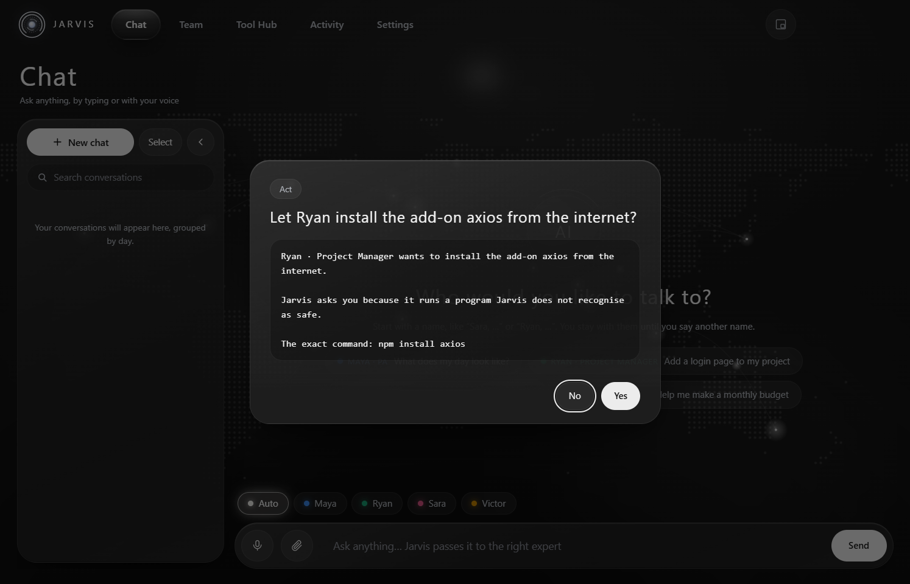

<div align="center">

# Jarvis

**Your own team of AI experts, on your desktop.**

A personal assistant, a project manager, a doctor and a finance advisor on your computer.
You talk to them by name, just like talking to a person, and they get the work done.
They run on **your own Claude Pro or Max plan**.

[**Download for Windows**](https://github.com/msja1729/Jarvis/releases/latest/download/Jarvis-Setup-0.9.1.exe) · [Project page](https://msja1729.github.io/Jarvis/) · [What Jarvis can do (PDF)](docs/Jarvis-Capabilities.pdf) · [All releases](https://github.com/msja1729/Jarvis/releases)


</div>

## Why Jarvis

In real life, some people have a personal assistant who runs their day, a family doctor they can call any time, an advisor for their money and a manager who keeps their projects on track. Most people have none of these. Jarvis gives everyone their own team: each member has a name, a voice and a field, remembers you, and is talked to like a person ("Sara, I've had a headache since yesterday"). This version is the first step towards that goal.

## Meet your team

| | Who | Ask them about |
|---|---|---|
| 🔵 | **Maya** · Personal assistant | your day, email, calendar, reminders, bills, forms, anything personal |
| 🟢 | **Ryan** · Project manager and tech lead | projects, meetings and minutes, deadlines, coding (he runs Claude Code) |
| 🔴 | **Sara** · Doctor and health coach | symptoms, lab reports, medicines, food, sleep, exercise (information, not a diagnosis) |
| 🟡 | **Victor** · Finance advisor | budgets, bills, savings, debt, investing basics, business numbers (information, not regulated advice) |

Start a message with a name, like *"Sara, …"*, and you stay with her until you name someone else. **Jarvis** is the front desk: if you don't name anyone, it passes your request to the right person. You can rename everyone and choose their voices on the Team page.


## What your team can do

**Talk to them like real people**
- Press **Ctrl+Alt+Space** in any app, speak, and the right member answers out loud in their own natural voice. Speech recognition and the voices run on your computer; your voice never leaves it.
- Before working, a member tells you what they will do and how long it takes ("On it, about 2 minutes"), then does it.
- The **voice card** above the taskbar (Ctrl+Alt+J) and the **floating chat box** (Ctrl+Shift+Space) can be moved, resized and minimised; whatever you ask there also shows in the main chat.
- Speak as long as you need: a long explanation, like a project's specification, is never cut, and you can pause to think.
- One switch, **Speak replies aloud**, decides whether answers are read out, everywhere. Music and videos pause while you talk, and when several members have something to say, they speak one at a time, never over each other.

**They know you**
- Each member keeps their own notes and profile files about you (Sara your health profile and every lab value, Victor your budget, Ryan your roadmap, Maya your routine and writing style) and uses them in every answer.
- Each follows the method of their field: Sara checks warning signs first, Victor reads your investment policy before any money decision, Ryan writes a spec before any coding.
- They ask each other for help and read each other's notes. They can also use Claude Code's own tools (files, web pages, Python for exact sums) in their own folder.

**They work at the same time**
- Ask Maya something, then Victor straight away: both work at once, and you can keep typing while they do.
- A member asks two or three teammates at once ("Ryan, ask Victor about the cost and Sara about the health side") and gets all the answers together.
- For big jobs a member starts helpers that work side by side (three countries' interest rates, five lab reports). Helpers only read and search, and the member writes the result after they report back, so nothing gets in each other's way.

**They work in your apps**
- Gmail, Google Calendar, Microsoft 365, Notion, Slack, Spotify and the rest of Claude's connectors: connect an app once on claude.ai (the Tool Hub opens the page and notices when it is connected) and your team can use it.
- You choose which member may use each app. Reading is allowed, anything that sends or changes something asks you first, and deleting or paying always asks.

**Meetings and lectures**
- "Ryan, record this meeting and note my tasks": Jarvis records your microphone, the computer's sound and the screen, with a picture of every new slide. You get a transcript, minutes that include the slides, and your tasks on the board with reminders.
- Say "listen along" during a lecture or call and ask "what did he just say?" or "explain that".
- During a recorded meeting, ask "what should I answer?": the reply appears quietly on the card, so nothing plays into the meeting.

**On time, every day**
- Reminders said out loud at the right time, in the member's own voice.
- Maya plans your morning and wraps up your day in the evening; a project board shared by Maya and Ryan.
- Sara sets a reminder for every dose of a prescription, for exactly the right number of days, plus the follow-up visit.
- Show Victor a bill and he files it and has Maya remind you before it is due; show Maya a form and she fills it, leaving passwords and ID numbers to you.

**Show them, and they show you**
- "Sara, I want to show you something": a drop box opens for a PDF, photo, video or recording, and she looks at it right away. Videos are understood scene by scene, with a timed transcript.
- When they make something for you (a plan, a report, a picture), it opens in a large preview next to the chat: documents with tables and flowcharts, pictures, PDFs, spreadsheets, video. Flip through several, or open any one big.

**Learn and work**
- Lessons: a narrated, step-by-step explanation plays beside your work, with diagrams, animated graphs and equations, at your level.
- They read a PDF, a file or a code folder you pick and quote the exact page or line, and look at your screen when you ask.
- "Ryan, build me a study planner app": you name the new project in a popup, and its spec and every code file go into its own folder in Ryan's Projects folder. Claude Code works in the background; Ryan brings you only the real decisions with his recommendation, in plain words ("Let Ryan install the add-on axios from the internet?"), and gives spoken updates. He can start your website and leave it running for you to try.
- Busy? Say so in your own words ("I'm in a meeting, sort it out with the team") or turn on **Team decides** on the coding card: the team makes the decisions without popups and tells you everything at the end. Publishing online, anything outside the project folder and password files are never done without you: they are skipped and listed for you.
- Web search steered to trusted sources, with the sources named. Conversations are kept by day, searchable, and can be continued.


<table>
<tr>
<td></td>
<td></td>
</tr>
<tr>
<td align="center">Team decides: the team handled Claude's questions and left publishing to you</td>
<td align="center">Permissions in plain words, with the exact command in small print</td>
</tr>
<tr>
<td></td>
<td></td>
</tr>
<tr>
<td align="center">Team: each member's field, skills, voice and memory</td>
<td align="center">Tool Hub: your apps, what each may do, and who can use it</td>
</tr>
</table>

## Make your team better

Out of the box they are good in their field; what you give them makes them *your* assistant, doctor, advisor and project manager. Open a member's folder from the **Team** page (**Open folder**): the files are ordinary documents, and your edits are never overwritten.

- **Fill in their Profile files** (the `Profile` folder). The facts there are read at the start of every conversation, so you never repeat yourself.
  Sara: *Health profile* and *Biomarkers.csv* (conditions, medicines, allergies, lab values). Victor: *Balance sheet*, *Cash flow*, *Investment policy*. Ryan: *Roadmap*. Maya: *About me*, *Writing style* (so her drafts sound like you).
- **Or just tell them once:** "Victor, I earn 60,000 a month after tax", "Sara, I'm allergic to penicillin". They write it into their profile themselves.
- **Give them your reference material** (the `Reference` folder): Ryan's *Coding standards*, *Spec template* and *Definition of done*; the ranges printed on your own lab's report in Sara's *Lab ranges*; your country's tax slabs and rates in Victor's *Rates and rules* (with the date you checked).
- **Teach them your own skills** (the `Skills` folder): a Markdown file whose first line says what it is for, then the steps or rules. They pick it when a task matches. For example, `Project Manager/Skills/Weekly status report.md`:
  ```markdown
  # Weekly status report for my team (every Friday, or when I ask for a status report)
  1. Read Roadmap.md and the board; list what was finished this week.
  2. List what is late, with the reason and a new date.
  3. Name the top 3 risks, each with one action.
  4. Under 200 words, in bullet points; save it in Projects/<project>/Status/ with today's date.
  ```
  More ideas: Sara: "My diabetes check-in"; Victor: "Monthly budget review" with your categories and limits; Maya: "How I want my inbox sorted". A skill can't switch off their safety rules.
- **Show them your documents:** lab reports, prescriptions, bank statements, bills, project briefs (paperclip, drop box or "Sara, I want to show you something"). They are kept in that member's folder for later.
- **Check and correct what they remember:** Team page → *What Sara remembers*. And when they get something wrong, say so ("No, I stopped that medicine in June"); they update their notes.
- **Give them the right apps** in the Tool Hub (Maya: email and calendar; Ryan: GitHub or Notion), and choose how they explain things in Settings.

## Install (Windows 10/11)

1. **[Download Jarvis-Setup-0.9.1.exe](https://github.com/msja1729/Jarvis/releases/latest/download/Jarvis-Setup-0.9.1.exe)** and run it.
   Windows may say *"Windows protected your PC"* because the installer is not code-signed yet: click **More info → Run anyway**.
2. A short welcome sets everything up: your name and how to say it, connecting your Claude (buttons install Claude Code and sign you in through your browser if needed), your team's tools, and the natural voices. Then each member introduces themselves.

<p align="center"></p>

**You need:** a **Claude Pro or Max** plan and about 2.5 GB of disk space after setup (less without an NVIDIA graphics card). Speech recognition is fastest with an NVIDIA graphics card; other computers work too, just more slowly.

To use email, calendar or other apps, open the **Tool Hub**, click **Connect an app**, and sign in to the app on claude.ai.

## You stay in control

- **Every action is checked.** For each app, reading, changing and deleting are each *Off*, *Ask me first* or *Allowed*; deleting and paying can never be set to Allowed. You choose which member may use each app. Everything your team did is listed on the **Activity** page.
- **Your data stays on your computer.** Chats, memory and team folders are kept in your Jarvis folder. Your voice is turned into text on your computer and never sent anywhere. Sign-ins to your apps are held by your Claude account, not by Jarvis.
- **Your Claude login is never read.** Jarvis runs Claude Code, which handles the sign-in itself. If an `ANTHROPIC_API_KEY` is set on your computer, Jarvis removes it for its own runs, so usage counts against your plan, not API billing.
- **Content is never obeyed.** Emails, web pages and documents are treated as information, never as instructions.

## Uninstall

Settings → **Uninstall**, or Windows Settings → Apps → Jarvis. This removes the app and everything it kept on your computer: settings, chats, memory, team folders, voices, saved keys and the Claude Code hooks it added. Claude Code itself, your own projects and any meeting videos you chose to keep (Videos → Jarvis Meetings) are not touched. Updating to a newer version keeps your data.

## Build from source

Requires Node.js 22+ and Claude Code signed in with a Claude Pro or Max plan.

```sh
npm install
npm start          # build and run
npm test           # tests (a stub claude is used, so no plan usage)
npm run typecheck
npm run dist       # Windows installer in release/
```

<details>
<summary>Project layout</summary>

```
app/         Electron main process, preload, the pages (renderer) and the orchestrator
router/      who answers (names only), local commands and model choice
roles/       the team: prompts, skills (playbooks), casebooks, folders and memory
brain/       the only code that runs claude (Claude Code CLI)
gateway/     every tool call: permission checks, confirmations, trimming, activity log
connectors/  apps from the user's Claude account: names, rules, who may use them
tools/       team folders, web, lessons, documents, coding supervisor, recorder, planner, screen, team…
speech/      whisper.cpp speech-to-text, Kokoro voices, media pause
security/    keychain storage, destructive-action lock
scripts/     build, docs PDF, app icon and installer pictures
docs/        project page, user guide and the capabilities report
tests/       unit and acceptance tests
```

</details>

---

Jarvis is an independent project and is not affiliated with or endorsed by Anthropic. Claude and Claude Code are products of Anthropic.
