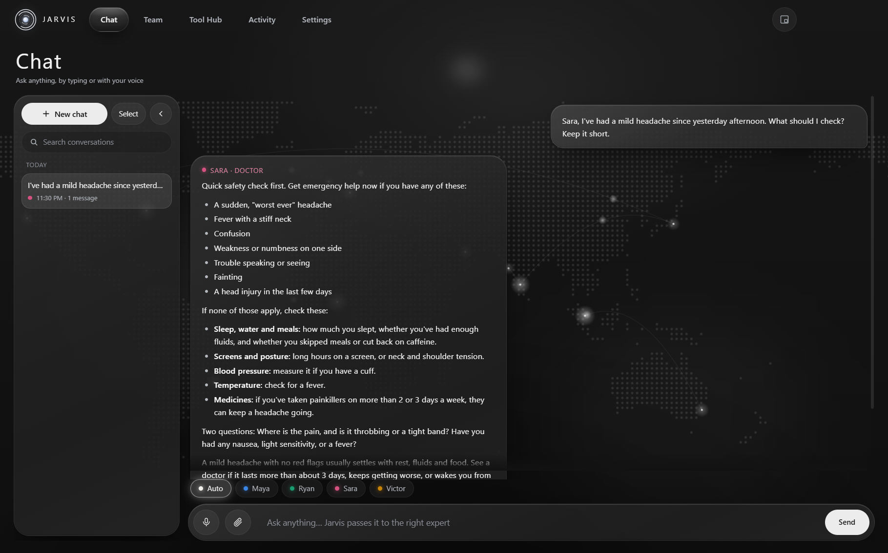
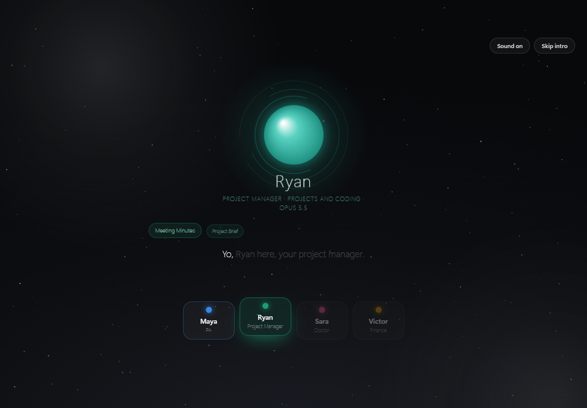
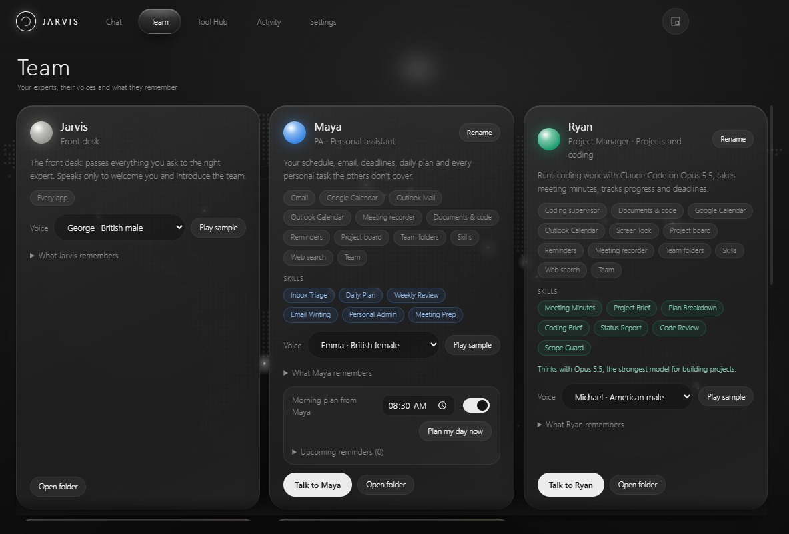
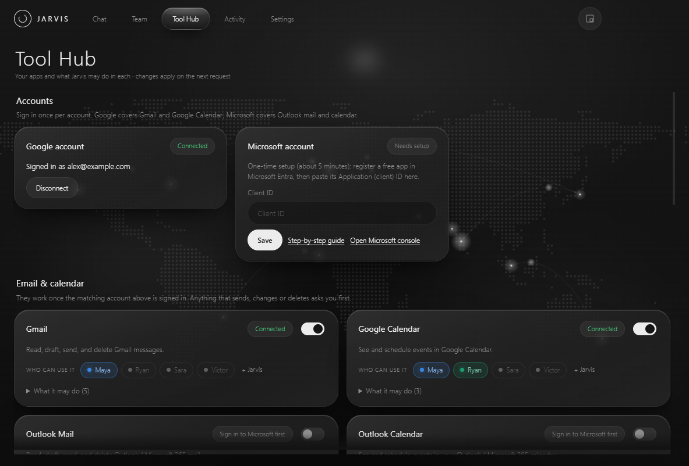
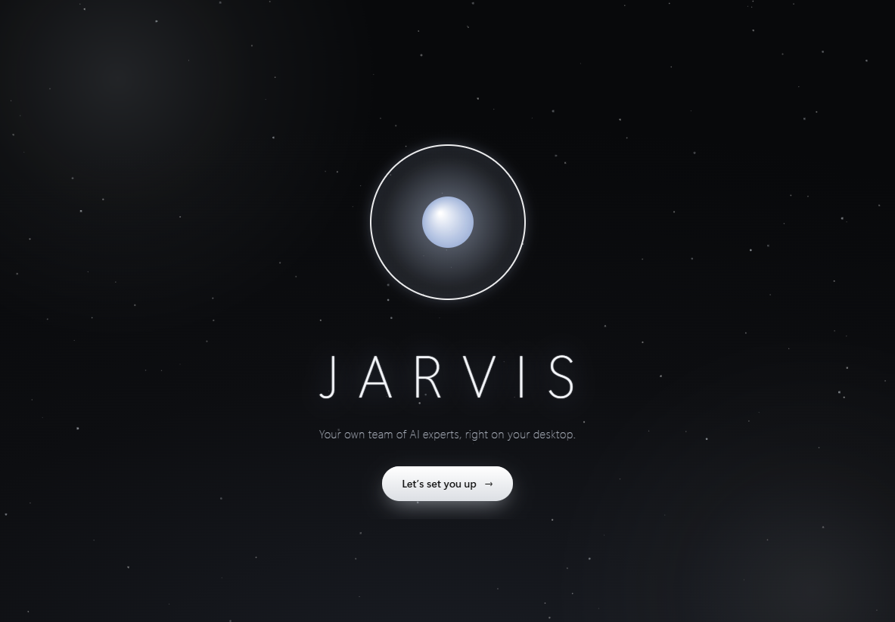

<div align="center">

# Jarvis

**Your own team of AI experts, on your desktop.**

Talk to a personal assistant, a project manager, a doctor and a finance expert, by typing or by voice.
They work in the apps you allow, remember what matters to you, and run on **your own Claude Pro or Max plan**.

[**Download for Windows**](https://github.com/msja1729/Jarvis/releases/latest/download/Jarvis-Setup-0.2.0.exe) · [All releases](https://github.com/msja1729/Jarvis/releases) · [What Jarvis can do (PDF)](docs/Jarvis-Capabilities.pdf)



</div>

## Meet your team

| | Who | Ask them about |
|---|---|---|
| 🔵 | **Maya** · Personal assistant | your day, email, calendar, deadlines, reminders, anything personal |
| 🟢 | **Ryan** · Project manager | projects, coding (runs Claude Code on Opus 5.5), meeting minutes, the project board |
| 🔴 | **Sara** · Doctor | symptoms, food, sleep, exercise, your lab reports (general information, not a diagnosis) |
| 🟡 | **Victor** · Finance | budgets, spending, investing basics, tax, business questions (information, not regulated advice) |

Start a message with a name, like *"Sara, …"*, and you stay with her until you name someone else. **Jarvis** is the front desk: it passes everything to the right person and introduces the team when you first open it. You can rename everyone and pick their voices.



## What they can do

- **Talk or type.** Press **Ctrl+Alt+Space** in any app, speak, and the answer is read aloud in a small card above the taskbar. Speech recognition and voices run on your computer.
- **Real expertise.** Each member follows detailed playbooks for their field (Sara's symptom check with red flags, Ryan's meeting minutes and project briefs, Victor's budgets and debt payoff, Maya's inbox triage and daily plan) and keeps a profile of you in their own folder.
- **Email and calendar.** Gmail, Google Calendar, Outlook mail and Outlook Calendar. Anything that sends, changes or deletes asks you first.
- **Web search** for everyone, steered to trusted sources (medical authorities for Sara, official sites for Victor, official docs for Ryan), with sources named.
- **Lessons.** Ask to learn something and a narrated, step-by-step lesson plays beside your work: diagrams, animated graphs, equations and notes.
- **Documents & code.** They read a PDF, text file or code folder you pick, and quote the exact page or line.
- **Coding supervisor.** "Ryan, add a login page to my project": Claude Code works in the background; you get its questions with a recommendation, and risky steps always wait for you.
- **Meetings.** "Ryan, record this meeting and note my tasks": a transcript, minutes, and your tasks on the board with reminders.
- **Reminders, morning plan and a project board** shared by Maya and Ryan.
- **They work together.** Members ask each other for help and read each other's notes.
- **Conversations** organised by day, searchable, and you can continue any of them.

<table>
<tr>
<td></td>
<td></td>
</tr>
<tr>
<td align="center">Team: skills, voices, memory and folders</td>
<td align="center">Tool Hub: what each app may do, and who can use it</td>
</tr>
</table>

## Install (Windows 10/11)

1. **[Download Jarvis-Setup-0.2.0.exe](https://github.com/msja1729/Jarvis/releases/latest/download/Jarvis-Setup-0.2.0.exe)** and run it.
   Windows may say *"Windows protected your PC"* because the installer is not code-signed yet: click **More info → Run anyway**.
2. Jarvis opens and sets itself up with you: your name (and how to say it), connecting your Claude (it installs Claude Code and signs you in if needed), tools and microphone, the natural voices, and then the team introduces itself.

<p align="center"></p>

**You need:** a **Claude Pro or Max** plan and about 2.5 GB of disk space after setup (less without an NVIDIA graphics card). Speech recognition is fastest with an NVIDIA graphics card; other computers work too, just more slowly.

To connect email and calendar, follow the one-time guides: [Google](docs/connect-google.md) · [Microsoft](docs/connect-microsoft.md).

## You stay in control

- **Every action is checked.** Each ability of each app is *Off*, *Ask me first* or *Allowed*, and anything destructive can never be set to Allowed. Everything your team did is listed on the **Activity** page, where you can delete it.
- **Your data stays on your computer.** Chats, memory and team folders are kept in your Jarvis folder. Sign-ins are stored only in Windows Credential Manager. Your voice is turned into text on your computer and never sent anywhere.
- **Your Claude login is never read.** Jarvis runs Claude Code, which handles the sign-in itself. If an `ANTHROPIC_API_KEY` is set on your computer, Jarvis removes it for its own runs, so usage counts against your plan, not API billing.
- **Content is never obeyed.** Emails, web pages and documents are treated as information, never as instructions.

## Uninstall

Settings → **Uninstall Jarvis**, or Windows Settings → Apps → Jarvis. This removes the app and everything it kept on your computer: settings, chats, memory, team folders, voices, saved sign-ins and the Claude Code hooks it added. Claude Code itself and your own projects are not touched. Updating to a newer version keeps your data.

## Build from source

Requires Node.js 22+ and Claude Code signed in with a Claude Pro or Max plan.

```sh
npm install
npm start          # build and run
npm test           # tests (a stub claude is used, so no plan usage)
npm run typecheck
npm run dist       # Windows installer in release/
```

<details>
<summary>Project layout</summary>

```
app/       Electron main process, preload, the pages (renderer) and the orchestrator
router/    who answers (names only), local commands and model choice
roles/     the team: prompts, skills (playbooks), casebooks, folders and memory
brain/     the only code that runs claude (Claude Code CLI)
gateway/   every tool call: ability checks, confirmations, trimming, activity log
tools/     email, calendars, web, lessons, documents, coding supervisor, recorder, planner, team…
speech/    whisper.cpp speech-to-text, Kokoro voices, media pause
security/  keychain storage, OAuth sign-in (PKCE), destructive-action lock
docs/      user guides and the capabilities report
tests/     unit and acceptance tests
```

</details>

---

Jarvis is an independent project and is not affiliated with or endorsed by Anthropic. Claude and Claude Code are products of Anthropic.
